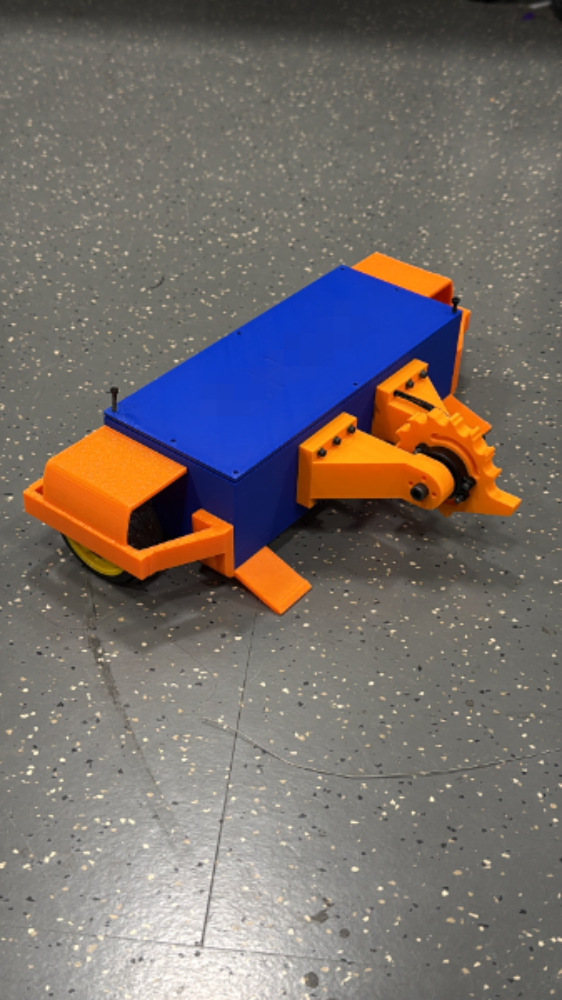
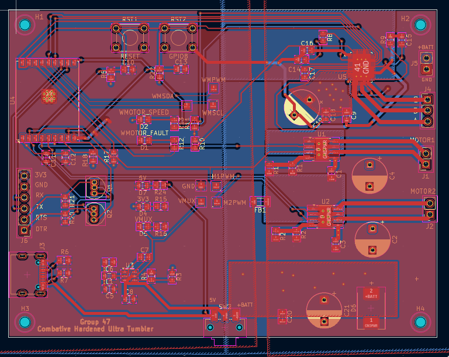

# Battlebot

A 2 lb antweight combat robot built for ECE 445 (Senior Design) at the University of Illinois Urbana-Champaign, Spring 2026. It runs on a custom ESP32 control PCB, drives two wheels plus a brushless spinning weapon, and is controlled wirelessly from an Xbox controller.



## Results

| Requirement | Target | Measured |
| --- | --- | --- |
| End-to-end wireless latency | under 100 ms | 75 ms |
| Command update rate | stable | 50 Hz |
| Wireless range | 15 ft line of sight | stable at 15 ft |
| Motor shutdown on signal loss | within 250 ms | within 250 ms (firmware watchdog) |
| Weight class | 2 lb antweight | met |

## System overview

- **Control** ESP32 firmware receives drive and weapon commands over BLE. A Python host script maps Xbox controller input to left/right motor PWM with deadzone, inversion and range limiting.
- **Power** 4S LiPo feeding a protected power path (switch, TVS diode) and a buck converter to a stable 3.3 V logic rail.
- **Actuation** Two brushed drive motors on the custom board. The brushless weapon was first driven with a TI MCF8316A and later moved to an external ESC using servo-style PWM for reliability.
- **Safety** A 250 ms command watchdog stops every motor if the controller link drops.
- **Mechanical** 3D-printed PLA chassis with bolt-on skids, wheel protectors, and brushless weapon motor arms, iterated through several print and fit cycles.

## Hardware

The PCB was designed in KiCad. Open `hardware/battlebot.kicad_pro` to view the schematic and layout.




## Mechanical design


The chassis is a low, wide box with defined internal zones for the battery, PCB, drive motors and wiring, so the electrical team could integrate without redesigning the shell. Skids, wheel protectors and weapon arms are separate bolt-on parts so each could be revised and reprinted on its own. A failed weapon shaft coupler in April led to a redesigned wheel-to-shaft mount and brushless-specific motor arms.

## Repository layout

```
assets/      Photos used in this README
hardware/    KiCad schematic, PCB layout, custom symbols and footprints
notebook/    Engineering lab notebooks for each team member, with build photos
```

## Team

| Member | Focus |
| --- | --- |
| Abhinav Garg | Firmware, controller interface, motor control, system verification |
| Rahul Krishnamoorthy | PCB, power path, protection, electrical testing |
| Shobhit Sinha | Chassis, motor mounts, skids, wheels, weapon mounting, printed-part design |

Full dated engineering notes live in [`notebook/notebooks`](notebook/notebooks). Original repositories by Abhinav Garg are at [ece445-pcb](https://github.com/AbhinavGarg90/ece445-pcb) and [ece445-lab-notebook](https://github.com/AbhinavGarg90/ece445-lab-notebook).
